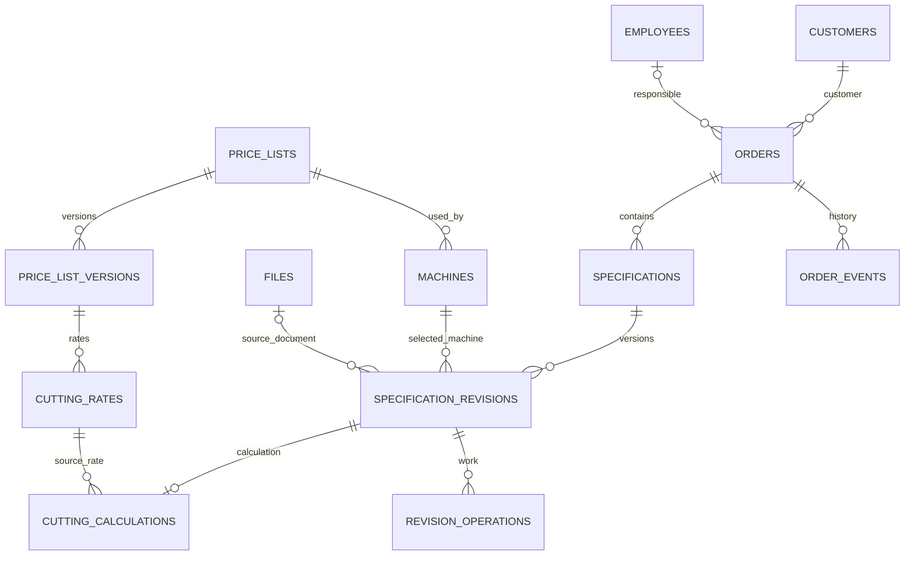

# Новая структура данных десктопного Journal

24.10.2026, ввод новой заявки реализован в локальном прототипе: только
менеджер/заказчик, автор и начальный технолог — из активного профиля при
сохранении. Личные подсказки в preferences.json не являются справочниками
общей БД; ID выбранных значений остаются в заявках. Разрешение имён/номера и
создание — одна локальная запись, неоднозначные имена отклоняются. Схема 7
прежняя. Для будущего Access требуется защита от одновременной регистрации
свободного имени без UNIQUE по фамилии/названию: кандидат координации и
обязательные нативные проверки описаны в
[проекте запросов](order-workflow-queries.md#создание-заявки-и-свободные-имена).

24.10.2026, корзина: orders.deleted_at/deleted_by, отдельные от archived_at.
Перемещение/восстановление сохраняют ID/номер/расчёты/историю/файлы и увеличивают
версию с событием аудита. Обычные команды отклоняют deleted_at IS NOT NULL.
Номера и ссылки справочников в корзине остаются занятыми. В схеме прототипа 7
CreatedById выделен отдельно и неизменяем: корзина не подменяет автора
последним событием. Восстановление не является копированием заявки.
Автоочистка/безвозвратное удаление не реализованы. Общие транзакции/индексы
Access остаются проектом — [контракт корзины](order-workflow-trash.md).

24.10.2026, последнее уточнение профиля: имя и цвет сотрудника хранятся
в employees, выбранный сотрудник (EmployeeId) и тема — локально на рабочем ПК.
Это выбор рабочего профиля, без пароля и без автоматического автора из имени
компьютера. Цвет не меняет ID/авторство заявок и не записывается в локальный
профиль. Чужая смена цвета проверяется условной записью по исходному состоянию;
будущий Access использует версию строки сотрудника. ARGB32 в Access — LONG
с сохранением тех же 32 бит, в .NET-представлении uint. Строки заявок сейчас
не окрашиваются, производственные статусы/шевроны не реализованы.
Локальная схема 6 добавляет необязательный цвет, миграция 5 сохраняет номера
и всю историю с копией исходника. Подробности/ограничения —
[профиль и отметки](order-workflow-profile-and-markers.md).

24.10.2026, подтверждён номер заявки по времени: yyyy-MM-dd-HHmmss без
префикса «З». ReferenceNumber хранится один раз, заказчик — отдельное поле,
внутренний registration_no и ID не меняются. При совпадении секунды добавляется
-02/-03 и далее. Текстовый номер не является FK и не вычисляется из текущих
часов при чтении. В локальной схеме 5 уникальность проверяется при записи
под существующей файловой блокировкой; миграции 1/2/3/4 сохраняют оригинал.
Для общей Access нужны UNIQUE reference_number и выделение номера в той же
транзакции, что создание заявки. Совпадения разрешаются чтением кандидатов
по индексу номера, без полной выгрузки orders; неизвестный commit сверяется
по command_id. Физические DDL/транзакции Access остаются следующим этапом.

Уточнение пользователя 24.10.2026: cutting_projects содержит станок и толщину
для подготовки, но не марку материала и не категорию тарифа. Эти данные
появляются при разборе отчёта и хранятся в specification_versions/revisions
со снимком параметров расчёта. Справочники материалов/категорий и ключ тарифа
сохраняются; до первого отчёта у проекта нет вымышленной марки/категории.
Начиная со схемы 4 исключены прежние поля подготовки; миграция с копией
оригинала сохраняет принятые расчёты, варианты и ссылки на архивные отчёты.

Уточнение MVP от пользователя 24.10.2026: категории тарифов работают как
в прежней программе. Для HTML (и текущих остальных профилей, кроме HansLaser)
используется «Базовая»; отдельный выбор/идентификатор категории нужен HansLaser.
Для HansLaser сохраняются -1/0 → базовая, 1 → нержавеющая, 2 → цветные металлы;
неизвестный ID не подменяется базовым и требует явной проверки. Категория
остаётся отдельным полем/связью модели, поэтому будущее расширение HTML не
требует переписывать историю и связи. Такое расширение сейчас не реализуется.

Проект пересмотрен 24.10.2026. По уточнению пользователя проектируем новую
реляционную БД с нуля; **из прежней БД берём только цены**. Заявки,
сотрудники, история, цвета, составное поле коэффициента и схема Orders не
переносятся. Действующий Journal и OrderDB.mdb не меняются.

Ориентир — 5–10 сотрудников в день, до 50 заявок в день, возможно меньше.
До 10 одновременно работающих клиентов используем как запас для проверки,
а не подтверждённый пик одновременной записи.

Это проект, не выполненная миграция. Приложение пока использует локальный
development-workspace.json схемы 7 с позициями/вариантами и метаданными снимков отчётов. Пользователь выбрал общий файл Access; таблицы этим
документом не создаются. Структура и алгоритмы ниже — проектные решения;
открытые бизнес-правила перечислены в конце. Коммиты/push/PR/релиз не поручены.
Конкретные чтения, индексы и измерения —
[order-workflow-queries.md](order-workflow-queries.md).

Новое уточнение 24.10.2026: проект иногда переделывается под другой станок
и расширение, при этом один проект по-прежнему даёт одну спецификацию.
[Предварительный сценарий](order-workflow-project-preparation.md) предлагает
стабильную позицию заявки и варианты: у каждого свой проект/спецификация,
у позиции одна ссылка на выбранный вариант. В итог попадает только он.
Общий номер позиции и суффикс варианта обсуждаются, не утверждены.

Прежнее предложение project_preparations с единственным PK specification_id
для всей позиции заменено этим предложением. Основная схема ниже пока
описывает исходный контур: перед DDL требуется включить order_items,
cutting_projects, связь 1:1 со specifications и принадлежность выбранного
варианта позиции. Готовность учитывает незавершённую переделку и старый
выбранный расчёт; точное поведение ещё согласуется.

Приоритет пользователя: грамотная структура и эффективные запросы.

[Обновление отчётов](order-workflow-specification-refresh.md) добавляет
связь рабочего пути с конкретной спецификацией, идентичность принятых байтов
и исходные распознанные значения для сохранения ручных правок. Один SourcePath
не различает новую редакцию файла с тем же именем. Пользователь предложил
сохранять принятые HTML/PDF; байты снимков — вне Access, в БД ссылки/хеши.
Точное размещение и DDL пока проект. Сканирование не выполняет DDL/DML
и не переписывает готовые расчёты от одного обнаружения файла.

Имена CAM/спецификаций сохраняют привычный вид по реальным образцам:
толщина, мм/mm, дата-время, станок. Номер позиции/вариант не подмешиваются
в рабочее имя. В модели нужны отдельные исходное имя/название проекта и ID/
номер варианта. Нельзя считать название глобальным ключом или вводить
UNIQUE по одному времени без согласованного разрешения коллизий. Схема
рассматривается вместе с конкретными чтениями/записями, а не отдельно от них.
Критерий следующего этапа — проверяемый Access DDL: связи/ограничения,
точные типы, минимальный обоснованный набор индексов, порционные чтения,
короткие транзакции и измерения на локальном файле/SMB. Красивый проект
таблиц без этих проверок не считается готовой БД.

## Выбранное размещение — Access, 24.10.2026

Пользователь выбрал файловую БД Microsoft Access: технологам знаком путь
к общему файлу, его можно взять домой для самостоятельных расчётов.
Служба PostgreSQL и серверная настройка в текущий этап не входят.

Приложение установлено локально у каждого технолога; рабочий файл Workflow
находится в общей папке компьютера-хранилища. Это новый файл с новой схемой,
не расширение прежней OrderDB.mdb. В приложении выбирается полный путь
к рабочему файлу либо к локальной копии.

Первый технический кандидат — MDB/Jet 4 x86: можно проверить существующий
способ доступа без обязательной установки Office/ACE. Пользователь выбрал
Access в целом, а не окончательное расширение/версию формата. MDB или ACCDB
и точный провайдер фиксируются после проверки десятичной точности, связей,
создания файла и поставки. Прежние SQL-операции AccessHost новую схему
автоматически не обслуживают. Для Workflow нужен отдельный набор операций.
Linux-прототип пока остаётся на JSON; запись Access на Linux не заявляется.

На том же компьютере уже есть «Расчёт заявок» с папками спецификаций:
проекты, карты раскроя, программы резки, PDF/HTML, DXF и чертежи на гибку.
Они остаются вне БД. Пример новых путей условный:

~~~text
\\ХРАНИЛИЩЕ\ОбщаяПапка\JournalWorkflow\JournalWorkflow.mdb
\\ХРАНИЛИЩЕ\ОбщаяПапка\Расчёт заявок\<папка спецификации>\...
~~~

Само приложение содержит UI/логику; файл Access — таблицы/связи/индексы.
Формы Access и макросы не нужны для запуска Workflow. Поддержка нужного
движка входит в проверку установки приложения на рабочих местах.
Запросы, типы и транзакции адаптируются к Access, не к PostgreSQL.

Для файлового подхода:

- короткие транзакции одной операции, проверка версии записи;
- ожидание только подтверждённой занятости с ограничением времени;
- неподтверждённая запись не повторяется автоматически;
- ввод, выбор и прокрутка сохраняются при отказе/обновлении;
- database_info с постоянным database_id и schema_migrations для версий;
- один мигратор после копии и исключительного доступа, без DDL в фоне;
- размер, рост истории и обслуживание проверяются на настоящем Access;
- права приложения не защищают от прямой правки пользователем с доступом
  к файлу. Внешняя правка через Access не считается соблюдением протокола
  content_version/неизменяемой истории Workflow.

Для MDB/ACCDB учитываем ограничение около 2 ГБ. PDF/HTML/чертежи хранятся
отдельно. Не добавляем сервер, внешнюю поисковую систему или секционирование.
Все сетевые сценарии проверяются несколькими Windows-клиентами: разные
заявки, одна спецификация, занятость, обрыв сети и восстановление.

### Граница текущего этапа

Возможность привычной работы с файлом и его копирования — основание выбора
Access. По следующему уточнению пользователя домашняя БД сейчас не является
приоритетом. Режимы домашних копий, распознавание веток, перенос документов,
обратный импорт и слияние не проектируем в текущем этапе. Этот вопрос
отложен, а не объявлен реализованным.

Текущий приоритет — структура нового файла, индексы/запросы, безопасная запись
и совместная работа технологов через общую папку. Обычные резервные копии
для сохранности рабочей БД остаются частью основного технического контура.

## Подтверждённая основа

- Главная сущность — заявка с постоянным внутренним ID. Менеджер и технолог
  могут передать её другому сотруднику; авторы прежних расчётов сохраняются.
- БЛЦБ присваивается позже и не является первичным ключом. По ответу
  пользователя номер, возможно, повторялся в разные годы. Глобальную
  уникальность номера не вводим. Год регистрации + номер — предложенная
  область проверки дубликатов, требующая сверки с архивом.
- Заявка объединяет несколько спецификаций. Одна версия спецификации —
  одна марка материала и одна толщина; геометрия листа и трубы различается.
- Сохраняем версии параметров, исходные файлы и расчёты. Гибка — работа,
  связанная со спецификацией, после резки. Подробное исполнение в цехе,
  согласование и оплата пока вне первого этапа.
- Новая формула: `(метры × тариф + пробивки × цена пробивки) × ручной коэффициент`.
  Гибка считается отдельно. Автоматическое вычисление коэффициента отменено.
- Из прежней MDB импортируются только цены и необходимые для сопоставления
  метаданные станков/категорий. Структура и остальные данные не наследуются.

## Связи

Это укрупнённая схема: два разных ответственных в заявке — менеджер и
технолог, а не одна универсальная связь responsible.

## 1. Сотрудники, заказчики, материалы

| Таблица | Основные поля | Правило |
| --- | --- | --- |
| `employees` | `id`, `display_name`, `color_argb`, `is_active`, `row_version` | Цвет общий, необязательный до настройки; непрозрачный ARGB32. Не удалять сотрудника с историей; одинаковые фамилии различать инициалами/выбором ID |
| `employee_roles` | `employee_id`, `role_code` | Менеджер / технолог; сотрудник может иметь обе роли |
| `customers` | `id`, `name`, `is_active` | Название не является ключом; одноимённые заказчики возможны |
| `material_groups` | `id`, `name`, `is_active` | Тарифная категория: базовая, нержавеющая сталь, цветные металлы |
| `materials` | `id`, `name`, `material_group_id`, `is_active` | Справочник помогает выбирать, но не запрещает свободную марку |

Сотрудник и способ входа в приложение — разные вопросы: менеджеру в справочнике
не обязательно иметь учётную запись. Способ аутентификации пока не выбран.
При реализации автора сохранения определяет текущий пользователь сеанса.

В версии спецификации сохраняется введённая марка даже при наличии
`material_id`: последующее переименование справочника не переписывает историю.
Неизвестную марку из AWJC нельзя незаметно заменить или подтвердить привязкой
к справочнику. Признаки проверки материала сохраняются отдельно.

## 2. Станки и прайсы

| Таблица | Основные поля |
| --- | --- |
| `machines` | `id`, `name`, `cutting_method_code`, `import_profile_code`, `price_list_id`, `is_active` |
| `price_lists` | `id`, `name`, `currency_code`, `current_version_id`, `row_version` |
| `price_list_versions` | `id`, `price_list_id`, `version_no`, `state`, `created_at`, `created_by`, `published_at` |
| `cutting_rates` | `id`, `price_list_version_id`, `material_group_id`, `thickness_mm`, `price_per_meter`, `price_per_pierce`, `origin_code`, `source_mapping_id` |

**Одна толщина — строка тарифа, не столбец и не отдельная таблица.**
Тариф уникален в пределах версии прайса, категории материала и толщины.
Базовая категория задаётся явно; отсутствие тарифа отличается от нулевой цены.

Технология (лазер, плазма, ГАР, труборез), конкретный станок, профиль импорта
и прайс имеют разные назначения. Профиль импорта не выбирает формулу и не
подменяет станок. Несколько станков могут использовать один прайс; это также
позволяет сохранить общие тарифы нынешнего журнала.

Категория материала нужна уже при переносе: HansLaser сейчас использует
базовый тариф и отдельные прайсы для нержавейки и цветных металлов. Строгая
пара «станок + толщина» потеряла бы эти различия. Газ сохраняется как параметр
спецификации; отдельную тарифную ось газа без подтверждённого правила не вводим.

Черновик версии прайса редактируется, опубликованная версия неизменна.
Изменение цен создаёт следующую версию. Переключение текущей версии — явное
действие. Ссылка на текущую версию должна принадлежать этому же прайсу.

UNIQUE `(price_list_id, version_no)` и `(price_list_id, id)` у версий;
FK `(id, current_version_id)` прайса → `(price_list_id, id)` версии.
Принадлежность обеспечивает FK; состояние published и запрет изменения
прошлых тарифов — транзакционная команда/защита выбранного движка.
Публикация требует обе известные цены, черновик может содержать NULL.
Происхождение строки — manual либо legacy_price_import; source_mapping_id
задан только для импортной строки и ссылается на стабильную идентичность
сопоставления. Менять источник/старый ключ существующего сопоставления нельзя:
новое соответствие получает новый ID. Это позволяет сохранять ручные строки
того же прайса при повторной загрузке и не угадывать происхождение по имени.

## 3. Заявки

`orders`:

- `id` — постоянный внутренний идентификатор;
- `registration_no` — уникальный внутренний последовательный номер;
- `reference_number` — постоянное деловое обозначение yyyy-MM-dd-HHmmss
  с -02/-03 и далее при совпадении секунды, обязательный TEXT(32), UNIQUE;
- `registered_on` — предлагаемая отдельная дата регистрации в журнале;
- `blcb_number`, `blcb_year`, `blcb_assigned_at` — необязательные реквизиты;
- `customer_id`, `manager_employee_id`, `technologist_employee_id`;
- `due_date`, `comment` — необязательные срок и общий комментарий;
- `created_at`, `created_by`, `updated_at`, `updated_by`, `archived_at`;
- `deleted_at`, `deleted_by` — корзина; оба null у активной заявки, иначе время
  UTC и сотрудник удаления. Это отдельно от будущего архива завершённых заявок;
- `row_version` — версия редактируемых общих реквизитов;
- `content_version` — маркер изменения заявки/её содержимого для UI.

Год БЛЦБ — год его регистрации, если такое правило подтвердится. Его нельзя
безусловно брать из даты спецификации или создания заявки. Номер хранится
текстом, чтобы не потерять ведущие нули и возможные составные обозначения.
До присвоения пара номер/год пустая. Возможную уникальность пары включаем
только после подтверждения области нумерации и проверки существующих данных.

`registration_no` выделяется генератором движка, не запросом MAX + 1.
Пропуски после отмены допустимы для внутреннего обозначения; бесперерывную
деловую нумерацию этим не вводим. Предложение для registered_on — день создания
в часовом поясе организации. Смысл даты журнала ещё нужно согласовать.

Сохранение спецификации увеличивает content_version, но не версию общих
реквизитов. Иначе правки разных спецификаций создадут ложный конфликт.
Короткая блокировка строки одной заявки допустима; общей версии всей БД нет.
Состояние «всё рассчитано» и сумму резки можно получать по текущим версиям
спецификаций; не хранить второй независимо редактируемый итог в заявке.
Пустая или частично заполненная заявка — не «рассчитана» и не нулевая смета.
Возвращаются число спецификаций, число рассчитанных и известная сумма.
Полный итог есть только у непустого полностью рассчитанного набора.
Текущий контур — рубли. Складывать разные currency_code запрещено.

## 4. Спецификация и её версии

`specifications` — стабильная связь внутри заявки:

- `id`, `order_id`, `position`, `current_revision_id`, `archived_at`, `row_version`.

UNIQUE `(order_id, position)`; позиция положительна. current_revision_id может
быть NULL до первой версии. Перенос между заявками отдельно не согласован.

`specification_revisions` — неизменяемый снимок сохранённых данных:

- `id`, `specification_id`, `revision_no`, `previous_revision_id`, `data_state_code`;
- `document_number`, `document_date` — номер и дата из заголовка документа;
- `machine_id`, `machine_name_snapshot`, `cutting_method_code`;
- `material_id` (может отсутствовать), `material_name`, `material_group_id`;
- `material_review_state`, `material_reviewed_by`, `material_reviewed_at`;
- `blank_kind` (`sheet` / `tube`), `thickness_mm`, `blank_quantity`;
- `part_count`, `pierce_count`, `cut_length_m`, `weight_kg`, `cut_duration_seconds`;
- `manual_coefficient`, `cutting_gas`, `comment`;
- `source_file_id` (может отсутствовать при ручном вводе), `import_profile_code`;
- `saved_at`, `author_employee_id`, `change_reason`.

Пара `(specification_id, revision_no)` уникальна. Текущая и предыдущая версии
должны принадлежать той же спецификации. Ручная правка толщины/марки создаёт
новую версию; одна версия не содержит смесь марок и толщин.

UNIQUE `(specification_id, id)` нужен для составных FK:
`(id, current_revision_id)` спецификации → `(specification_id, id)` версии;
`(specification_id, previous_revision_id)` → `(specification_id, id)`.
Следующий номер и связь с прежней текущей проверяются командой под блокировкой
спецификации; межстрочный CHECK этого не обеспечивает.

Прежние версии/авторы не импортируются, отдельный recorded_by для такого
импорта не нужен. Импорт новой HTML/PDF-спецификации сохраняет сотрудник
сеанса; import_profile_code указывает происхождение распознанных полей.

data_state_code — incomplete либо ready. Неполная версия допускает неизвестные
поля как NULL без выдуманной даты/нуля/расчёта. Готовая требует обязательные
параметры и проверенный материал. UX неполных сохранённых версий ещё не
реализован: прототип требует готового расчёта. material_review_state различает
not_required/pending/confirmed; подтверждение имеет автора/время.
Фокус и подсказка не подтверждают AWJC-материал.

Дата документа не заменяется текущей датой, временем загрузки или именем файла.
`saved_at` хранит отдельное фактическое время сохранения. Количество пробивок,
деталей, длина и вес — итоги спецификации: повторно умножать их на листы нельзя.
Метаданные парсера должны явно установить, являются ли данные итогами.

Предлагаемые типизированные детали геометрии:

| Таблица | Поля |
| --- | --- |
| `sheet_revision_details` | `revision_id` (PK/FK), `sheet_width_mm`, `sheet_length_mm` |
| `tube_revision_details` | `revision_id` (PK/FK), `profile_kind`, `outer_diameter_mm`, `width_mm`, `height_mm`, `blank_length_mm` |

Толщина стенки трубы хранится в общем `thickness_mm`. Тип профиля определяет,
какие размеры обязательны. Конкретные поля трубореза уточняются по образцам;
его таблица — задел, не утверждённый контракт импорта. Не использовать
универсальную таблицу «имя параметра — строковое значение» вместо типов.
Соответствие геометрии blank_kind и полноту проверяет единая команда/
отложенная проверка движка: обычный CHECK основной строки не читает другую
таблицу. Известные размеры положительны, неизвестные — NULL.

## 5. Сохранённый расчёт

`cutting_calculations` — максимум один расчёт на сохранённую версию:

- `revision_id` — PK/FK;
- `source_rate_id` — FK конкретного тарифа опубликованной версии прайса;
- `price_per_meter`, `price_per_pierce`, `currency_code` — снимок тарифов;
- `length_cost`, `pierce_cost` — составляющие до общего коэффициента;
- `raw_total`, `payable_total` — точный итог и итог по явной политике;
- `formula_version`, `rounding_policy_code`, `calculated_at`.

Длина, пробивки и ручной коэффициент берутся из связанной неизменной версии.
Формула первого нового расчёта:

`raw_total = (cut_length_m × price_per_meter + pierce_count × price_per_pierce) × manual_coefficient`.

Тарифы копируются осознанно: это исторический снимок, а не случайное
дублирование справочника. Смена прайса не пересчитывает прежние версии.
Явное обновление тарифов при сохранении создаёт новую версию расчёта.
Пустая или непроверенная спецификация может сохраняться без расчёта;
отсутствующий расчёт нельзя отображать как цену 0.

Прежние расчёты не импортируются. Ручной тариф сначала сохраняется в прайс,
без фиктивной ссылки source_rate_id. Ключи и снимок цены сверяются с неизменной
строкой тарифа. Публикация новых цен не отменяет явно выбранный исторический
снимок; обязательную свежесть цены при записи нужно согласовать отдельно,
если такое правило понадобится.

Округление и минимальная стоимость ещё не согласованы. Они должны получить
явную версию правила до реализации; не наследовать незаметно старую формулу
Double/ToEven или минимальную сумму только для письма.
Текущее проектное правило exact/no-minimum: payable_total = raw_total.
Все компоненты сохраняет один расчётчик, без расходящихся формул UI/SQL.

## 6. Работы

`revision_operations`:

- `id`, `revision_id`, `position`, `kind_code` (`cutting`, `bending`);
- `depends_on_operation_id` — например, гибка после резки этой же версии;
- `scope_code` (`all_parts` / `specified_parts`), `scope_description`, `comment`.

Отметка «Гибка» создаёт связанную работу, а снятие убирает её из следующей
версии. Старый маршрут остаётся в прежней версии. Нет повторного флага
HasBending в другой таблице, способного противоречить перечню работ.
Зависимости принадлежат той же версии и не образуют циклов.

UNIQUE `(revision_id, position)`, UNIQUE `(revision_id, id)`;
составной FK зависимости `(revision_id, depends_on_operation_id)` →
`(revision_id, id)` и CHECK против самоссылки. Циклы и допустимый состав
проверяет команда под блокировкой спецификации. Каталог operation_kinds
допускает фаску после реализации UI/правил; структура не означает готовую
функцию. Порядок пометок письма не задаёт производственный маршрут.

Сейчас это список необходимых работ. Фактические задания цеху и исполнение
позже получают отдельные записи, привязанные к конкретной версии операции.
Новый расчёт не должен незаметно менять уже выданное задание. Формула и цена
гибки пока не определены; отсутствие цены гибки не означает бесплатную гибку.
Статус, ответственный и цвет раздельны. Область «Комментарий → В работе»
не определена. Задания/исполнение не входят в первый DDL до согласования
сценария; mutable-состояние не помещается внутрь неизменяемой версии.

## 7. Файлы и события

| Таблица | Назначение |
| --- | --- |
| `storage_roots` | `id`, название и корневой сетевой путь, например к «Расчёту заявок» |
| `specification_folders` | `specification_id`, `storage_root_id`, относительный путь к рабочей папке спецификации |
| `files` | `id`, имя, `storage_root_id`, относительный путь, вид ссылки (`working_reference` / `version_snapshot`), MIME-тип, известные размер и SHA-256, время регистрации |
| `order_files` | Приложения ко всей заявке: `order_id`, `file_id`, назначение |
| `revision_files` | Чертежи и другие приложения конкретной версии: `revision_id`, `file_id`, назначение |
| `order_events` | Заявка, необязательные ссылки на спецификацию/версию, время, действующий сотрудник, тип события и краткие изменения |

Спецификация связывается с существующей рабочей папкой по ID. Имя папки
не становится ID спецификации: номера могут повторяться, папки могут
переименовывать. Деловое имя/номер и путь — разные поля. Общий корень задаётся
сетевым путём, без зависимости от букв дисков отдельных пользователей;
смена корня не требует переписывать относительный путь каждой папки.
Автоматическое переименование/перенос рабочих папок не согласованы.

Главная исходная спецификация привязана через `source_file_id`; её не нужно
второй раз объявлять исходником в `revision_files`. Рабочие файлы остаются
в прежней структуре и не требуют обязательного импорта каждого DXF/проекта.
В карточке предлагаются «Открыть папку» и открытие связанных документов.
Открытие заявки не должно запускать полный рекурсивный разбор/хеширование
проектов и DXF. Регистрация автора файла не доказывает, что он создал документ.

**Ссылка на рабочий файл не является неизменяемой исторической копией.**
Файл могут перезаписать вне Journal; один путь и сохранённый хеш не позволяют
восстановить прежние байты. Предложение для обсуждения: при сохранении версии
сохранять отдельную неизменяемую копию её исходной PDF/HTML-спецификации.
Расположение таких снимков и необходимость включать выбранные чертежи ещё
не утверждены. Автоматическое копирование всех проектов, программ станка и
DXF каждой версией не предлагается как обязательное правило.

Для `working_reference` приложение может обнаружить недоступность или изменение
файла, но не обещает показать старый файл. Для `version_snapshot` замена создаёт
новый объект, старый не удаляется при наличии ссылок. БД, рабочие папки и
снимки версий резервируются согласованно. Отказ доступа к папке показывается
отдельно, без утраты уже сохранённых параметров и расчётов.

Связи файлов — настоящие внешние ключи; избегать общей пары `entity_type / id`
без проверки существования объекта. Для событий допустим небольшой
структурированный снимок изменённых полей, но он не заменяет основные таблицы.
Для order_events нужны отдельные event_code/actor_id и составные FK,
проверяющие принадлежность спецификации заявке, версии — спецификации.
Для этого у родителей нужны UNIQUE `(order_id, id)` и
`(specification_id, id)`. Полный event sourcing не вводим.

Передача заявки записывает прежнего и нового ответственного и того, кто
выполнил передачу. Время и автор версии расчёта не переписываются.

## 8. Типы и совместная работа

Предлагаемые логические типы (точный DDL зависит от выбранной СУБД):

- ID — UUID/GUID; деловые номера и названия — текст, не внешние ключи по имени.
  Для MDB проверяется нативный GUID, не строковые сравнения GUID.
- Версии и внутренний номер — целые; физический тип зависит от формата.
  MDB Long/Counter — 32-bit, логический Int64 нельзя объявить уже поддержанным.
  Предел, checked-преобразования и вариант точного DECIMAL при необходимости
  64-bit фиксируются первым DDL. Номера не выделяются через MAX + 1.
- День документа — отдельное поле Access DATETIME с проверкой полуночи;
  события — UTC в DATETIME с единым преобразованием провайдера. Не полагаться
  на отдельные native DATE/timestamptz. Плановый срок — отдельный день.
  Проверить точность времени и переход границы суток при чтении/записи.
- Толщина/размеры, цены и коэффициент — точные десятичные числа.
  Access DECIMAL имеет precision до 28 и фиксированную scale. Нельзя
  наследовать PostgreSQL NUMERIC без scale или молча выбрать Currency
  с четырьмя знаками. До DDL определить пределы и scale каждого поля,
  точность произведений и политику округления; проверять отсутствие скрытой
  квантизации. Входы вне согласованной точности отклоняются с причиной,
  не обрезаются. Float/Double для новых денежных расчётов не выбираем.

- Длина — десятичные метры, вес — десятичные кг. Округление импортируемой длины
  до целых метров — отдельное правило, а не свойство типа хранения.
- Длительность предлагается хранить целыми секундами, включая значения больше
  суток, а показывать ЧЧ:ММ с округлением вверх. Для источника с минутной
  точностью не выдумывать точность секунд; физический целый тип проверить.
- Пробивки/детали — целые числа; неизвестное значение NULL отличается от 0.
  Количество заготовок — Decimal, чтобы не потерять прежние дробные значения;
  допустимость дроби зависит от вида заготовки и проверяется явно.
- Цены и известные количества неотрицательны; толщина положительна.
  Положительный коэффициент с начальным значением 1 — предложение новых форм,
  не повод скрывать неизвестный параметр.

Сохранение новой версии, её расчёта, работ, события и переключение текущей
версии выполняются одной транзакцией. Пользовательское редактирование не
держит транзакцию открытой. `row_version` проверяется при сохранении: чужие
изменения нельзя молча затереть. Неизменённая форма не создаёт новую версию.

Если будет утверждено создание снимка исходного файла, сначала надёжно
сохраняются его байты, затем транзакция связывает готовый снимок с версией.
Транзакция БД сама по себе не гарантирует атомарность файловой системы.
Обычная ссылка на внешнюю рабочую папку может стать недоступной позже;
такую ссылку нельзя выдавать за гарантированно сохранённый снимок.

Индексы проектируются под конкретные чтения: дата/порядок журнала,
ответственный, БЛЦБ; спецификации по заявке и позиции; версии по владельцу
и номеру; тарифы по версии прайса/категории/толщине; события по заявке и времени.
Обязательные ограничения и кандидаты разделены в документе запросов.
Стратегия текстового поиска выбирается после СУБД и оценки объёма, без
обещания ускорения произвольного поиска одним индексом.

## 9. Наполнение новой БД — только цены

Первый запуск создаёт пустую новую БД по версионированной миграции. Прежние
заявки/сотрудники/история не переносятся. Прототипный JSON с вымышленными
сотрудниками не импортируется молча в продуктивную БД.

Для цен нужны:

- `price_import_sources`: постоянный ID источника и описание/путь;
- `price_import_mappings`: источник, стабильный ключ старой таблицы/категории,
  целевой прайс/категория, row_version;
- `price_imports`: ID успешной загрузки, source_id, command_id, imported_by,
  imported_at, rate_count; версии прайсов могут ссылаться на загрузку.

UNIQUE `(source_id, source_table_key, source_category_key)` у сопоставления.
Хеш всего MDB описывает конкретный снимок, не постоянный ID источника.
Имя нового станка не становится ключом сопоставления. Общий прайс нескольких
станков задаётся явно, не совпадением чисел в двух таблицах.

1. Прежние адаптеры читают цены и необходимую для сопоставления информацию,
   без подготовки схемы/CRUD или чтения заявок ради переноса.
2. Предпросмотр разворачивает колонки толщин в строки. Категории HansLaser,
   нули и NULL различаются; ошибка не допускает частичного применения.
3. Начальная цена пробивки новых тарифов — **1 ₽**, по явному поручению
   пользователя. Это правило Workflow, не прочитанное значение MDB.
   При повторной загрузке настроенные пробивки сохраняются.
4. Явное применение создаёт версии затронутых прайсов, переключает текущие
   версии и записывает успешный импорт одной короткой транзакцией. Проверяются
   row_version прайсов и сопоставлений; конфликт сохраняет предпросмотр.
5. Одинаковый набор — no-op. Исчезнувший импортный тариф отсутствует в новой
   версии; старые версии/расчёты сохраняются. Ручные прайсы и ручные строки
   того же прайса остаются по origin_code/source_mapping_id. Совпадение
   входящего ключа с ручной строкой требует явного разрешения в предпросмотре,
   без молчаливой перезаписи. Правка цены импортной строки не теряет её
   происхождение; следующее обновление показывает замену метровой цены,
   сохраняя уже настроенную пробивку.

Предпросмотр не держит транзакцию. Несколько чтений живой старой MDB не
объявляются согласованным снимком; для начального наполнения нужна копия.
Постоянной синхронизации и обратной записи нет.

## 10. Целостность, запись и восстановление

Основные правила защищает БД: PK/FK, NOT NULL, UNIQUE, CHECK и составные FK
принадлежности текущей/предыдущей версии. CHECK не заменяет NOT NULL.
Для Access отдельно проверяется, какие ограничения реально обеспечивает
выбранный формат/провайдер. FK/UNIQUE/обязательные поля задаются в файле.
Неизменность истории/прайсов обеспечивает единый путь записи и проверка
снимков; серверные роли, процедуры и PostgreSQL-триггеры не предполагаются.
Пользователь с прямым доступом к файлу может обойти правила приложения;
абсолютную неизменяемость против внешней правки не обещаем.
Справочники с историческими ссылками деактивируются без каскадного удаления.

Сохранение версии, геометрии, расчёта, работ, события, переключение текущей
версии и увеличение content_version заявки — одна транзакция. Общие реквизиты
проверяют orders.row_version, спецификации — собственный row_version и
current_revision_id. Нет общей optimistic-версии всего workspace.
Порядок блокировок и алгоритм — в документе запросов.

Для неизвестного исхода проектируется `command_receipts`: command_id PK,
command_kind, actor_id, payload_hash, recorded_at и небольшой типизированный
результат с ID/версиями. Квитанция фиксируется в той же транзакции.
recorded_at — время записи квитанции, не точный момент/порядок commit.
Повторный ID с другим составом отклоняется; автоматический повтор после
обрыва не включается. Отсутствие квитанции до завершения транзакции не
доказывает откат. Срок очистки нужно определить до удаления квитанций.

Для карточки из нескольких SELECT требуется проверенная согласованность
на Access. BEGIN TRANSACTION не объявляется MVCC-снимком. В первом проекте
проверяются content_version до/после чтения и состав порции; при изменении —
ограниченное перечитывание только чтения. Подробности в документе запросов.
Изоляция провайдера, видимость commit и блокировки проверяются нативно.

`schema_migrations` хранит версии/контрольные суммы; DDL выполняет один
мигратор, не каждое рабочее место при автообновлении. Совместимость клиента
проверяется до записи. Нужны backup и проверка восстановления; для файлового
движка также нужный исключительный доступ. Простое копирование изменяемой
открытой БД не объявляется надёжным backup. БД и снимки документов резервируются
согласованно, копии нужны на отдельном устройстве.

Основания для Access:
[типы](https://learn.microsoft.com/en-us/office/client-developer/access/desktop-database-reference/sql-data-types),
[индексы](https://learn.microsoft.com/en-us/office/client-developer/access/desktop-database-reference/create-index-statement-microsoft-access-sql),
[транзакции ADO](https://learn.microsoft.com/en-us/office/client-developer/access/desktop-database-reference/begintrans-committrans-and-rollbacktrans-methods-ado).
Создание/проверка ограничений и реальный состав индексов являются отдельными
проверками первого DDL на выбранном файловом формате.

## До реализации нужно решить

1. Access выбран. Уточнить MDB/ACCDB, провайдер/разрядность и физические
   типы/ограничения; проверить поставку и совместную работу.
2. Реальную область нумерации БЛЦБ и смысл его года.
3. Округление, минимум, пределы и точность входных величин/результата.
4. Дату отбора журнала заявок отдельно от даты документов спецификаций.
5. Способ входа сотрудников и права редактирования/передачи.
6. Параметры трубореза, объём частичных работ, статусы исполнения и область
   «Комментарий → В работе»; UX неполных сохраняемых спецификаций.
7. Где хранить неизменяемые исходные спецификации для версий и какие ещё
   документы включать в историю файлов; рабочие папки остаются внешними.

Реализацию общего Access-адаптера начать после проверки формата/DDL и согласования первого
вертикального сценария: создать заявку → импортировать спецификацию →
рассчитать метры и пробивки → сохранить версию → перечитать историю.
